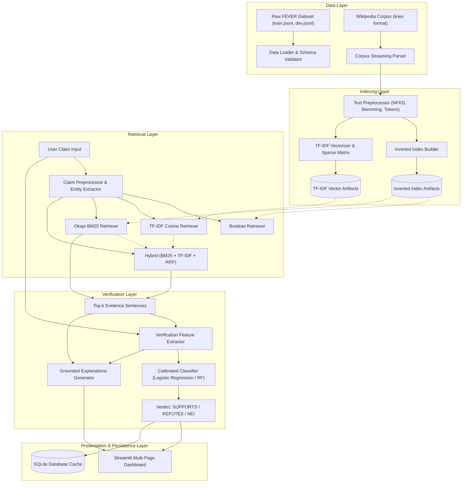

# System Architecture: FEVER Information Retrieval & Fact Verification

## 1. High-Level Architectural Overview

The **FEVER Fact Verification & Information Retrieval System** is designed as a modular, decoupled, pipeline-oriented software architecture. The system decomposes automated fact verification into two coordinated stages:
1. **Candidate Evidence Retrieval (Information Retrieval Stage)**: Given a natural language factual claim, identify and rank relevant sentences from a Wikipedia knowledge base.
2. **Evidence-Grounded Fact Verification (NLP & Verification Stage)**: Given the claim and the retrieved top-$k$ evidence sentences, extract linguistic/relational features and classify the claim into `SUPPORTS`, `REFUTES`, or `NOT ENOUGH INFO`.

---

## 2. Component Specifications

### 2.1 Text Preprocessor (`src/preprocessing/text_preprocessor.py`)
- **Unicode Normalization:** Applies NFKD decomposition to decompose diacritics and ligatures, ensuring character matching consistency across Wikipedia entities.
- **Tokenization:** Uses regular-expression token splitting that preserves hyphenated terms, alphanumeric identifiers, and contractions.
- **Negation Preservation:** Specifically maintains negation operators (`not`, `no`, `never`, `neither`, `cannot`) even when stopword removal is active, as negation reverses the truth value of a factual claim.
- **Stemming:** Implements Porter Stemming to collapse inflectional variants (e.g., `landed`, `landing`, `land`).
- **Entity & Number Extraction:** Uses regular expressions to identify capitalized named entity candidates and numeric values (e.g., years, measurements).

### 2.2 Inverted Index (`src/indexing/inverted_index.py`)
- **Postings List:** Maps each stemmed vocabulary term to a postings list:
  $$\mathcal{P}(t) = [(\text{doc\_id}_1, \text{tf}_1), (\text{doc\_id}_2, \text{tf}_2), \dots]$$
- **Document Metadata Records:** Retains original sentence text, Wikipedia page titles, sentence IDs, and token lengths.
- **Collection Statistics:** Stores total indexed documents ($N$), average document length ($\text{avgdl}$), and total tokens.

### 2.3 Retrieval Engines (`src/retrieval/`)
- **BooleanRetriever:** Parses expressions with `AND`, `OR`, and `NOT`, intersecting and differencing postings lists.
- **BM25Retriever:** Implements Okapi BM25 ranking directly over postings with term frequency saturation ($k_1$) and length normalization ($b$).
- **TfidfRetriever:** Vector Space model with sublinear TF scaling ($1 + \ln(\text{tf})$) and Cosine Similarity.
- **HybridRetriever:** Two-stage retrieval employing Reciprocal Rank Fusion (RRF) and entity-guided candidate boosting.

### 2.4 Verification Engine (`src/verification/`)
- **Feature Extractor:** Converts `(claim, top-k evidence)` into a 14-dimensional feature vector capturing lexical overlap, containment, negation mismatches, numeric mismatches, and retrieval confidence.
- **Classifier:** Calibrated multi-class Logistic Regression trained on FEVER training split with balanced class weights.
- **Abstention Mechanism:** Automatically routes claims with zero or sub-threshold evidence to `NOT ENOUGH INFO`.

### 2.5 Storage Resolver (`src/utils/config_loader.py`)
- Detects OS-level access controls (such as Windows Defender Controlled Folder Access in OneDrive/Documents) and seamlessly manages write paths with user-home fallback (`~/.fever_cache/artifacts/`) ensuring uninterrupted execution.
